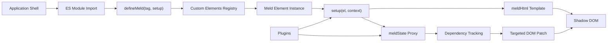
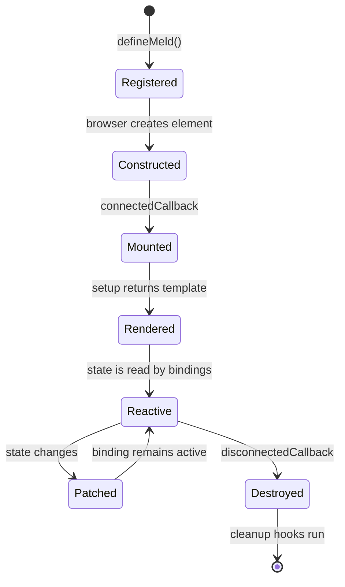
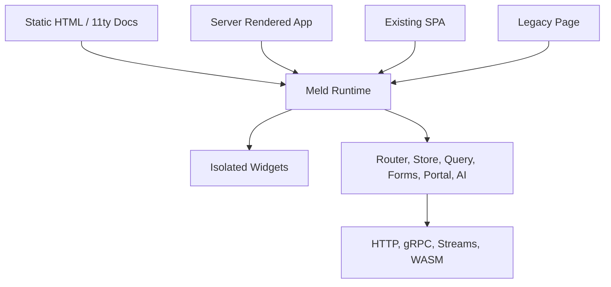

# Meld Architecture

Meld connects browser-native custom elements, proxy-backed state, template bindings, and plugins into isolated UI units that can run inside static pages, SPAs, server-rendered apps, and micro-frontend surfaces.

## Runtime Topology

The runtime starts with a component definition, creates a custom element, attaches rendering work to that element, and limits updates to the reactive bindings that changed.



## Component Lifecycle

Each component owns its setup, DOM attachment, reactive subscriptions, and cleanup. Plugins extend the context without requiring a framework runtime.



## Usage Patterns

Meld can be used as a small client-side runtime, a widget layer inside server-rendered applications, or an integration surface for plugin-backed features.



## Integration Model

Meld code is imported where a page needs a component. The browser handles element registration and lifecycle execution.

```javascript
import { defineMeld, meldHtml, meldState } from './src/meld.core.js';

defineMeld('task-counter', () => {
  const state = meldState({ count: 0 });

  return meldHtml`
    <button onclick="${() => state.count++}">
      Count: ${() => state.count}
    </button>
  `;
});
```

## Architecture Reference

| Layer | Responsibility | Primary API |
| :--- | :--- | :--- |
| Definition | Registers a custom element tag and setup function. | `defineMeld` |
| State | Wraps mutable data in a proxy and notifies dependent bindings. | `meldState` |
| Template | Produces DOM output and captures reactive reads. | `meldHtml` |
| Lifecycle | Runs setup and cleanup around browser connection state. | `onMount`, `onDestroy` |
| Plugins | Adds feature modules without changing component ownership. | `use`, plugin exports |
| Integration | Embeds components into existing HTML or app shells. | Browser custom elements |
